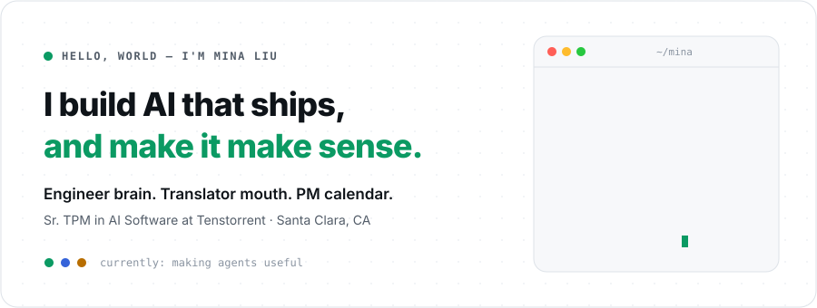
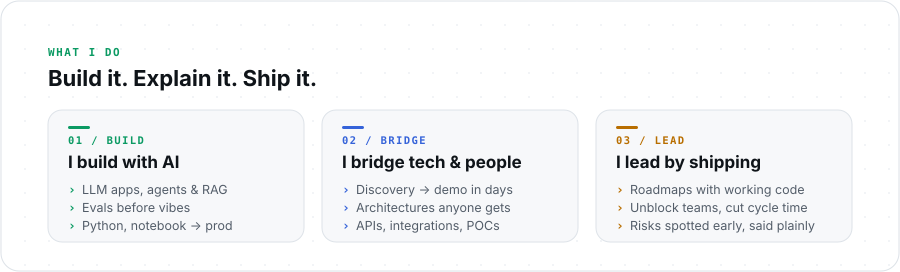
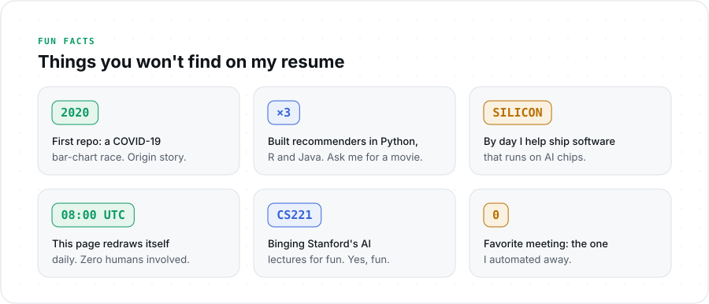
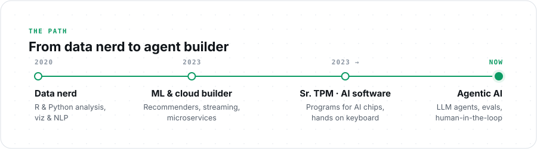
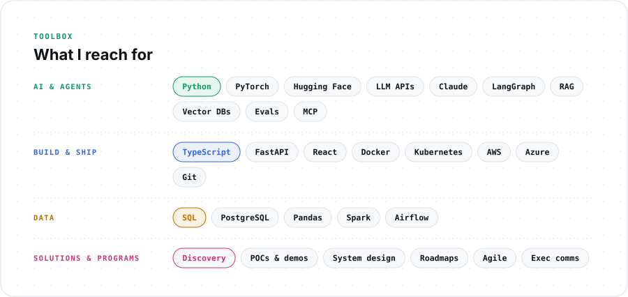
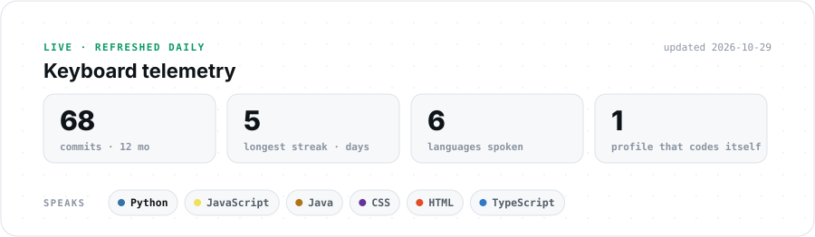

<!-- Graphics are generated by scripts/svg_assets.py — edit CONTENT there, not the SVGs. -->

<picture>
  <source media="(prefers-color-scheme: dark)" srcset="./assets/hero_dark.svg">
  
</picture>

  
  
  

> **TL;DR** — I prototype with AI, explain it so anyone can follow, and drive it all the way to production. Half builder, half translator, fully allergic to slide decks that never ship.

<picture>
  <source media="(prefers-color-scheme: dark)" srcset="./assets/what_dark.svg">
  
</picture>

<picture>
  <source media="(prefers-color-scheme: dark)" srcset="./assets/facts_dark.svg">
  
</picture>

<picture>
  <source media="(prefers-color-scheme: dark)" srcset="./assets/journey_dark.svg">
  
</picture>

<picture>
  <source media="(prefers-color-scheme: dark)" srcset="./assets/stack_dark.svg">
  
</picture>

<picture>
  <source media="(prefers-color-scheme: dark)" srcset="./assets/stats_dark.svg">
  
</picture>

Psst — every graphic here is drawn by <a href="./scripts/svg_assets.py">Python</a> and redrawn each morning by a <a href="./.github/workflows/update-profile.yml">GitHub Action</a>. Hands-on, as promised.

